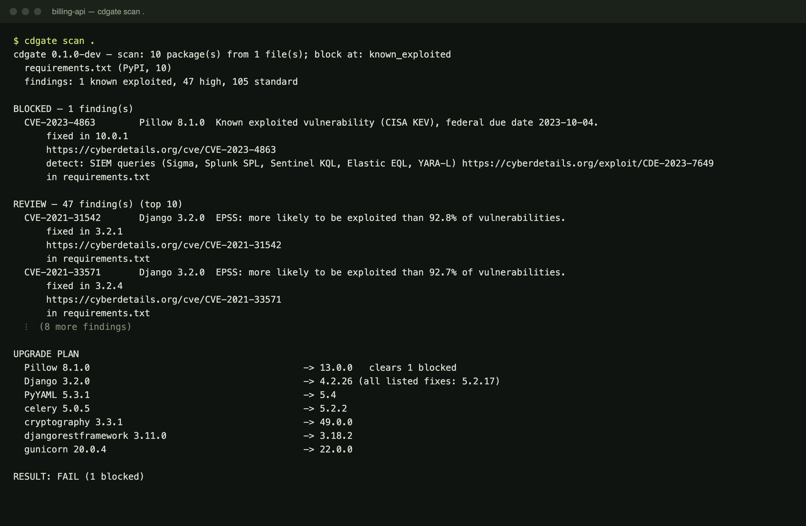
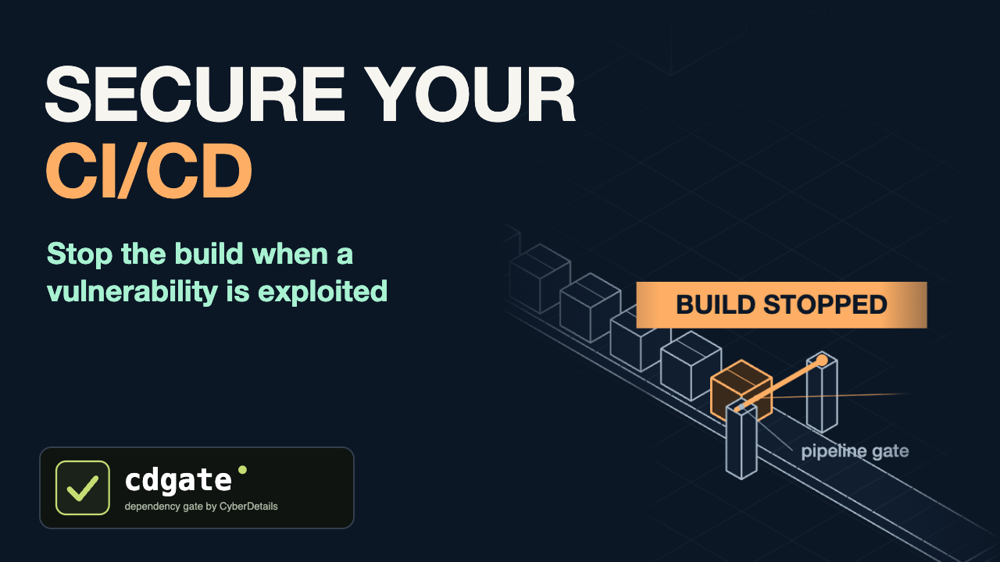

<p align="center">
  
</p>

<p align="center"><b>English</b> | <a href="README.tr.md">Türkçe</a></p>

# cdgate

Your project has hundreds of dependency CVEs. `cdgate` tells you which few
are being exploited in the wild, fails the build on those and shows the
upgrade that clears them.



*Real output: `cdgate scan .` on a test service with ten old Python packages.*

## Watch

<a href="https://www.youtube.com/watch?v=p4mLJFHlF50"></a>

[Secure Your CI/CD Pipeline with CyberDetails Gate](https://www.youtube.com/watch?v=p4mLJFHlF50)
(1:45): install, add it to your pipeline, read the results.
[Türkçe video](https://www.youtube.com/watch?v=EGh15u_YHGI).

> **Status: preview.** There is no prebuilt binary yet; install with Go.

## Install

You need [Go](https://go.dev/dl/) 1.22 or newer.

```sh
go install github.com/cyberdetails/cdgate/cmd/cdgate@latest
```

Or build from source:

```sh
git clone https://github.com/cyberdetails/cdgate
cd cdgate
go build -trimpath -o cdgate ./cmd/cdgate
```

No account and no key are needed. Nothing is downloaded: `cdgate` asks the
CyberDetails API online.

## Use it in your project

Run it in the project folder:

```sh
cdgate scan .
```

It reads your lockfiles (`package-lock.json`, `requirements.txt`, `go.mod`,
`Cargo.lock`, `composer.lock`, `Gemfile.lock` and more) and prints three
things: what is **blocked**, what to **review**, and the **upgrade plan**.

Other inputs:

```sh
docker save -o image.tar myapp:latest
cdgate image image.tar        # a container image
cdgate sbom bom.cdx.json      # a CycloneDX or SPDX SBOM
```

## Use it with Trivy

Already running Trivy (or Grype)? Keep it. Give its JSON report to `cdgate`;
it ranks the findings and decides whether the build fails.

```sh
trivy fs --format json --output trivy.json .
cdgate gate trivy.json
```

Only the CVE identifiers leave your machine in this mode.

No Go on the runner? The same gate is one Python file with no dependencies
(Python 3.8+):

```sh
curl -fsSLO https://raw.githubusercontent.com/cyberdetails/cdgate/main/cd_sca_gate.py
python3 cd_sca_gate.py trivy.json
```

In CI, pin the URL to a commit hash instead of `main`.

## Use it in CI/CD

The exit code is the whole integration:

| Exit | Meaning |
|---|---|
| 0 | pass |
| 1 | blocked: at least one finding fails your policy |
| 2 | the check did not run or is incomplete (never a silent pass) |

**GitHub Actions**: save as `.github/workflows/dependency-gate.yml`:

```yaml
name: Dependency gate
on: [push, pull_request]
permissions:
  contents: read
jobs:
  cdgate:
    runs-on: ubuntu-latest
    steps:
      - uses: actions/checkout@v4
      - uses: actions/setup-go@v5
        with:
          go-version: stable
      - run: go install github.com/cyberdetails/cdgate/cmd/cdgate@latest
      - run: cdgate scan .
```

**With Trivy in the same job**: replace the last step with:

```yaml
      - run: docker run --rm -v "$PWD:/w" ghcr.io/aquasecurity/trivy:0.76.2 fs --quiet --format json -o /w/trivy.json /w
      - run: cdgate gate trivy.json
```

**GitLab CI**: add to `.gitlab-ci.yml`:

```yaml
dependency-gate:
  image: golang:1.22
  script:
    - go install github.com/cyberdetails/cdgate/cmd/cdgate@latest
    - cdgate scan .
```

**Any other CI** (Jenkins, Bitbucket, Azure DevOps): run the same two
commands in a job that has Go:

```sh
go install github.com/cyberdetails/cdgate/cmd/cdgate@latest
cdgate scan .
```

## Choose what fails the build

```sh
cdgate scan . --block-at high
```

| `--block-at` | Fails the build on |
|---|---|
| `cisa_kev` | CISA KEV only |
| `known_exploited` (default) | vulnerabilities known to be exploited |
| `high` | the above, plus high-risk ones (high score, high EPSS, public exploit module) |
| `never` | nothing: report only |

## What leaves your machine

- `scan`, `sbom`: ecosystem, package name and version of each package.
- `image`: the same; RPM packages add the architecture, and Red Hat and
  CentOS images add the image's content sets and container NVR
  ([details](docs/reference.md#what-leaves-your-machine)).
- `gate`: CVE identifiers only.
- Never: file paths, repository names, host names, the names of your own
  projects.

The API is free. Anonymous use is rate limited per IP address; set a free key
in the `CD_API_KEY` environment variable for a higher limit.

## More

- Full reference (every input, policy details, API, accuracy):
  [docs/reference.md](docs/reference.md)
- Try it in the browser: <https://cyberdetails.org/sca/check>
- License: [Apache-2.0](LICENSE)
