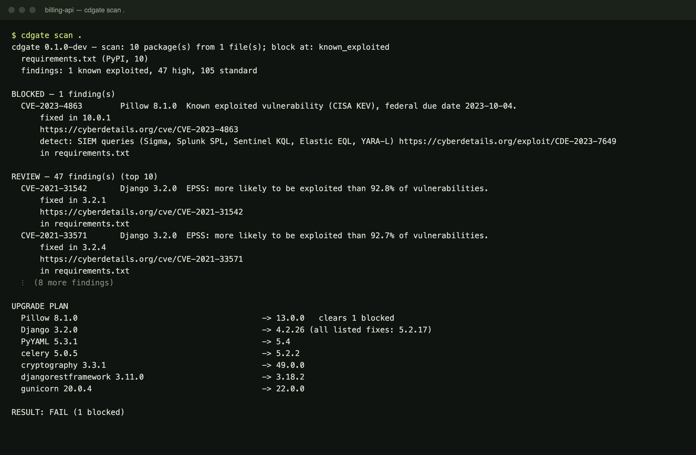
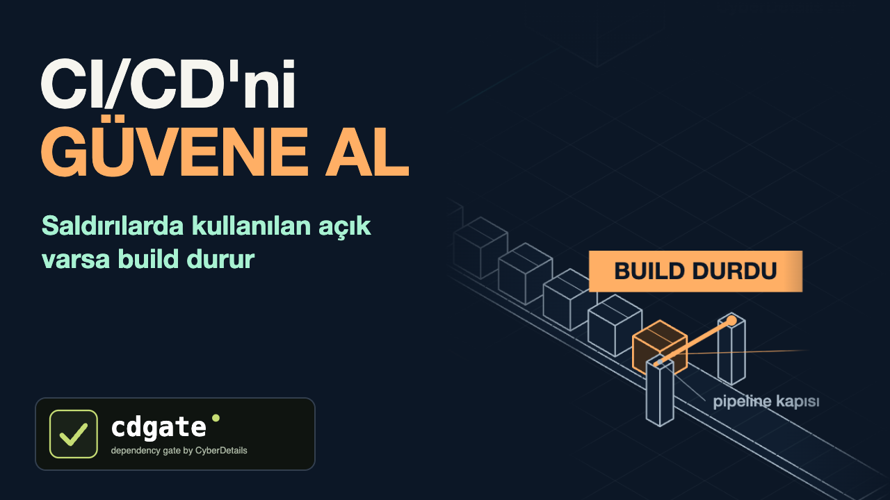

<p align="center">
  
</p>

<p align="center"><a href="README.md">English</a> | <b>Türkçe</b></p>

# cdgate

Projenizin bağımlılıklarında yüzlerce CVE çıkar. `cdgate` bunlardan hangilerinin
gerçekten saldırılarda kullanıldığını söyler, build'i yalnızca onlar için
durdurur ve hangi sürüme yükseltmeniz gerektiğini gösterir.



*Gerçek çıktı: on eski Python paketi olan bir test servisinde `cdgate scan .`*

## Video

<a href="https://www.youtube.com/watch?v=EGh15u_YHGI"></a>

[CyberDetails Gate ile CI/CD Pipeline'ını Güvene Al](https://www.youtube.com/watch?v=EGh15u_YHGI)
(1:48): kurulum, pipeline'a ekleme, sonuçları görme.
[English video](https://www.youtube.com/watch?v=p4mLJFHlF50).

> **Durum: önizleme.** Hazır derlenmiş dosya henüz yok; Go ile kurulur.

## Kurulum

[Go](https://go.dev/dl/) 1.22 veya daha yenisi gerekir.

```sh
go install github.com/ferhatcil/cdgate/cmd/cdgate@latest
```

Ya da kaynaktan derleyin:

```sh
git clone https://github.com/ferhatcil/cdgate
cd cdgate
go build -trimpath -o cdgate ./cmd/cdgate
```

Hesap ya da anahtar gerekmez. Bilgisayarınıza veritabanı inmez: `cdgate`
CyberDetails API'sine çevrimiçi sorar.

## Projeme nasıl eklerim?

Proje klasöründe çalıştırın:

```sh
cdgate scan .
```

Kilit dosyalarınızı okur (`package-lock.json`, `requirements.txt`, `go.mod`,
`Cargo.lock`, `composer.lock`, `Gemfile.lock` ve diğerleri) ve üç şey yazar:
neyin **engellendiği** (BLOCKED), neye **bakmanız gerektiği** (REVIEW) ve
**yükseltme planı** (UPGRADE PLAN).

Diğer girdiler:

```sh
docker save -o image.tar myapp:latest
cdgate image image.tar        # container imajı
cdgate sbom bom.cdx.json      # CycloneDX ya da SPDX SBOM
```

## Trivy ile nasıl kullanırım?

Zaten Trivy (ya da Grype) kullanıyorsanız bırakmayın. JSON raporunu `cdgate`'ya
verin; bulguları sıralar ve build'in durup durmayacağına karar verir.

```sh
trivy fs --format json --output trivy.json .
cdgate gate trivy.json
```

Bu kullanımda bilgisayarınızdan yalnızca CVE numaraları çıkar.

## CI/CD'ye nasıl eklerim?

Bütün entegrasyon çıkış kodudur:

| Çıkış kodu | Anlamı |
|---|---|
| 0 | geçti |
| 1 | engellendi: en az bir bulgu kuralınıza takıldı |
| 2 | kontrol çalışmadı ya da eksik kaldı (asla sessizce "geçti" demez) |

**GitHub Actions**: `.github/workflows/dependency-gate.yml` olarak kaydedin:

```yaml
name: Dependency gate
on: [push, pull_request]
permissions:
  contents: read
jobs:
  cdgate:
    runs-on: ubuntu-latest
    steps:
      - uses: actions/checkout@v4
      - uses: actions/setup-go@v5
        with:
          go-version: stable
      - run: go install github.com/ferhatcil/cdgate/cmd/cdgate@latest
      - run: cdgate scan .
```

**Aynı işte Trivy ile**: son adımın yerine şunları yazın:

```yaml
      - run: docker run --rm -v "$PWD:/w" ghcr.io/aquasecurity/trivy:0.76.2 fs --quiet --format json -o /w/trivy.json /w
      - run: cdgate gate trivy.json
```

**GitLab CI**: `.gitlab-ci.yml` dosyasına ekleyin:

```yaml
dependency-gate:
  image: golang:1.22
  script:
    - go install github.com/ferhatcil/cdgate/cmd/cdgate@latest
    - cdgate scan .
```

**Diğer CI araçları** (Jenkins, Bitbucket, Azure DevOps): Go kurulu bir işte
aynı iki komutu çalıştırın:

```sh
go install github.com/ferhatcil/cdgate/cmd/cdgate@latest
cdgate scan .
```

## Build'i ne durdursun?

```sh
cdgate scan . --block-at high
```

| `--block-at` | Build'i durduran |
|---|---|
| `cisa_kev` | yalnızca CISA KEV listesi |
| `known_exploited` (varsayılan) | saldırılarda kullanıldığı bilinen açıklar |
| `high` | yukarıdakiler ve yüksek riskliler (yüksek puan, yüksek EPSS, hazır exploit modülü) |
| `never` | hiçbir şey: yalnızca rapor |

## Bilgisayarınızdan ne çıkar?

- `scan`, `sbom`: her paketin ekosistemi, adı ve sürümü.
- `image`: aynısı; RPM paketlerinde mimari, Red Hat ve CentOS imajlarında
  ayrıca imajın içerik kümeleri ve container NVR bilgisi
  ([ayrıntı](docs/reference.md#what-leaves-your-machine)).
- `gate`: yalnızca CVE numaraları.
- Asla: dosya yolları, repo adları, makine adları, kendi projelerinizin
  adları.

API ücretsizdir. Anahtarsız kullanım IP adresi başına sınırlıdır; daha yüksek
sınır için ücretsiz anahtarınızı `CD_API_KEY` ortam değişkenine koyun.

## Devamı

- Tam başvuru belgesi (İngilizce; bütün girdiler, kural ayrıntıları, API,
  doğruluk): [docs/reference.md](docs/reference.md)
- Tarayıcıda deneyin: <https://cyberdetails.org/sca/check>
- Lisans: [Apache-2.0](LICENSE)
